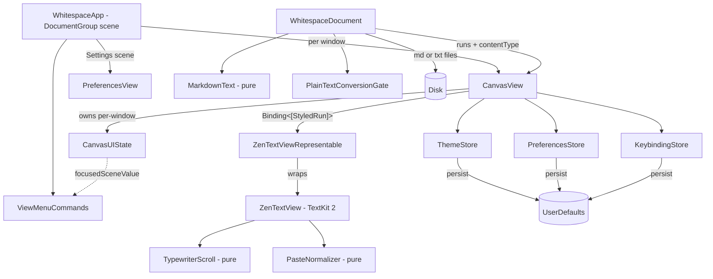

# Whitespace — Architecture

*Final document of the fable-review-1 engagement: Phase 1 audit (`a204d70`), Phase 2 refactors (R1–R8), Phase 3 markdown documents (P3.1–P3.8). Supersedes `ARCHITECTURE_REVIEW.md` and the Phase 3 plan (both in git history). Written for future development sessions, including AI sessions on weaker models: the conventions in §4 are rules, not suggestions. When this document and the code disagree, fix one of them in the same change.*

---

## 1. Structure

Whitespace is a single-target macOS writing app: a SwiftUI document-based shell around one substantial AppKit editor view.

### Documents (data layer)

`WhitespaceDocument` (a `FileDocument` value type) is the only document model: `runs: [StyledRun]` + `contentType` (`.plainText` or the imported markdown UTI). It delegates serialization to `MarkdownText` (encode/decode) and consults `PlainTextConversionGate` before any write that would flatten formatting.

NSDocument/DocumentGroup machinery provides — natively, do not hand-roll any of these — untitled documents, save/Save As panels with the format picker, close/quit review sheets, autosave, unsaved-state restoration across relaunch, window-per-document, and the system File menu.

**Launch** is the one place that machinery needed correcting. With nothing to restore, AppKit opens the app-centric `NSOpenPanel` instead of an untitled document; a leftover autosaved document masks it, so the panel looks intermittent. `LaunchDelegate` (`WhitespaceApp.swift`, installed via `NSApplicationDelegateAdaptor`) reads that outcome in `applicationDidFinishLaunching` and swaps a panel for a new document. **The untitled-file delegate hooks cannot be used**: SwiftUI keeps `SwiftUI.AppDelegate` as `NSApp.delegate`, and an adaptor object receives only the delegate methods AppKit posts as notifications — `applicationShouldOpenUntitledFile` / `applicationOpenUntitledFile` compile, run, and are never called. Restoration publishes its documents *after* that notification, so an absent panel means a session is still arriving and must not be covered with a blank page.

### Stores (state layer)

Three `@Observable @MainActor final class`es created in `WhitespaceApp`, injected via `.environment()`:

| Store | Owns | Persistence |
|---|---|---|
| `PreferencesStore` | font size, line height, column width, scroll speed, overlay settings, new-document type | UserDefaults |
| `ThemeStore` | current/previous `Theme`, manual ~60 fps transition loop, color interpolation | UserDefaults |
| `KeybindingStore` | 6 customizable editor delete actions | UserDefaults (JSON `ShortcutBinding`) |

`CanvasUIState` (palette/overlay visibility) is **per-window**: each `CanvasView` owns one and publishes it with `.focusedSceneValue(\.canvasUI, ui)`; `ViewMenuCommands` reads it via `@FocusedValue` so ⌘P/⌘/ act on the key window only. Stores never import views and never reference each other directly.

### Views

`CanvasView` (per document window) = `GrainBackground` + centered `ZenTextViewRepresentable` + `CommandPaletteView` (an action palette: New/Open via `NSDocumentController` send-actions) + `ShortcutOverlayView`. `PreferencesView` lives in the Settings scene. Window chrome (hidden title bar, hidden traffic lights) is configured only in `WindowStylingView` — `viewDidMoveToWindow`, re-asserted on become-key and sheet-end because DocumentGroup re-asserts its own chrome.

### Editor

`ZenTextView` (NSTextView subclass, TextKit 2) owns: typewriter scrolling (single scroll authority — `scrollRangeToVisible` routes through `recenter`), custom caret (`CursorBarView` + blink + system-indicator suppression), `keyDown` dispatch for non-menu chords, bold/italic in markdown mode (`formattingEnabled`), paste normalization, and the faithful runs extractor `currentStyledRuns()`. Pure logic lives beside it:

- `TypewriterScroll.target(for:)` — scroll placement/deadzone decision
- `PasteNormalizer` — staged paste/drag normalization
- `MarkdownText` — markdown encode/decode (the document's serialization)

### Data flow for text

Keystroke → `ZenTextView` → delegate `textDidChange` → `currentStyledRuns()` → `Binding<[StyledRun]>` → `WhitespaceDocument.runs` (NSDocument tracks dirty state and autosaves). External change (revert, restoration) flows back through `updateNSView`, which rebuilds the storage from runs and **must** run the established reset block (§4.4).

## 2. The document dialect (normative)

| | `.md` (markdown) | `.txt` (plain) |
|---|---|---|
| ⌘B / ⌘I | Toggle bold/italic | **Silently inert** — no beep, no reaction (owner decision) |
| Paste | Keeps bold/italic, strips everything else | Strips all styling |
| On disk | `**bold**`, `*italic*`, `***both***`; prose `\`-escapes `` \ * _ ` [ < ~ `` | Exactly the characters on screen |
| `isRichText` | true | false |

Rules that must not regress:
- **The user never sees markdown syntax in a markdown document** — it is a storage format only.
- **Underline does not exist anywhere in the app.** `StyledRun` has no underline field; do not add one (markdown cannot express it).
- New documents default to `.md`; Settings ▸ Documents ▸ New Files switches the default (`whitespace.prefs.newDocumentType`). The mechanism is the ORDER of `readableContentTypes`/`writableContentTypes`: SwiftUI's private document controller (`SwiftUI.PlatformDocumentController`, installed before `applicationWillFinishLaunching` — it cannot be replaced or subclassed) types untitled documents and defaults the save panel from the first entry, ignoring `defaultType` overrides and the instance's `contentType`. Keep both lists preference-ordered.
- Saving formatted content to `.plainText` triggers one warning via `PlainTextConversionGate` (suppression: `whitespace.prefs.suppressPlainTextConversionWarning`). `fileWrapper` must never present UI — it throws `userCancelled`; the gate re-drives the save after approval.
- Dialect limits (accepted): only bold/italic round-trip; foreign markdown constructs (links, code spans; block syntax is never interpreted) flatten to their visible text on load; a file's single trailing newline is dropped on first load (stable thereafter).

## 3. What the engagement changed

| | Change |
|---|---|
| R1 | Undo enabled; undo stack cleared on wholesale content replacement |
| R2 | Dead command-layer code deleted (menu-duplicate `keyDown` branches never ran) |
| R3 | FileStore data-safety trio *(later superseded by NSDocument in P3.3)* |
| R4 | Palette/overlay real menu items; working palette keys; focus returns to editor |
| R5 | Auto-save policy into the store *(superseded by NSDocument autosave in P3.3)* |
| R6 | Scroll math extracted into `TypewriterScroll` with characterization tests |
| R7 | Keybinding Record button wired (NSEvent monitor, conflict surfacing) |
| R8 | Local cleanups; panel ink into `Theme`; first `ARCHITECTURE.md` |
| P3.1–2 | `MarkdownText` encoder/decoder, round-trip tested |
| P3.3 | NSDocument architecture adopted (`feat/nsdocument-markdown` reconciled; FileStore/FileBuffer retired) |
| P3.4 | Documents carry `[StyledRun]`; editor syncs attributed content |
| P3.5 | Per-type editor modes; underline removed app-wide |
| P3.6 | New-file type preference (.md default) |
| P3.7 | Plain-text conversion warning with suppression |

## 4. Conventions for new code (rules)

1. **New shared state** = `@Observable @MainActor final class`, UserDefaults injected through `init(defaults:)` for testability, keys namespaced `whitespace.<area>.<name>`. No singletons (the conversion gate's static one-shot flag is the lone, documented exception), no Combine, no protocol-for-one-implementation.
2. **New command/shortcut**: add a real menu item — that is the single dispatch point for any chord a menu can express. Never add a disabled placeholder menu item. Never duplicate a menu chord in `keyDown` (dead code; the menu intercepts first). `keyDown` is only for chords menus can't own (⌘B/⌘I/⌘+/⌘− and `KeybindingStore` lookups). Menu commands that need window state read `@FocusedValue(\.canvasUI)` in a `Commands` struct — never a shared app-wide UI-state object. When adding an app-level shortcut, also update `ShortcutOverlayView.appShortcuts`.
3. **Keyboard handling in SwiftUI overlays**: `.onKeyPress`/`.onMoveCommand`/`.onExitCommand` do NOT fire while an AppKit field editor has focus. Use the `CommandPaletteView` patterns: `.onSubmit` for Return, invisible `Button` + bare `.keyboardShortcut` for arrows, local `NSEvent` monitor (installed `onAppear`, removed `onDisappear`) for Escape.
4. **Wholesale content replacement** (`updateNSView` external-change branch) must keep the reset block together: `invalidateScrollAnchor()` → `undoManager?.removeAllActions()` → rebuild storage via `PasteNormalizer.attributedString(runs:baseAttributes:)`. Breaking it up reintroduces stale-anchor scrolling, cross-document undo, or unstyled text.
5. **Document I/O**: serialization lives in `MarkdownText`/`encodedData` (pure, testable); `fileWrapper` stays thin and UI-free. Anything destructive at write time goes through a gate (see `PlainTextConversionGate`), never a dialog in the write path.
6. **Editor logic** that is decision-shaped (geometry, classification, normalization, serialization) lives in a pure type with value inputs and unit tests — `TypewriterScroll`, `PasteNormalizer`, `MarkdownText` are the exemplars. TK2/AppKit calls stay in the view; decisions move out.
7. **Tests**: XCTest; stores with `UserDefaults(suiteName:)` + domain wipe in tearDown; `ZenTextView` behavior via offscreen `NSWindow` hosting (`ZenTextViewUndoTests`); `keyDown` via constructed `NSEvent.keyEvent` chords; round-trip tests for any serialization. **Offscreen hosting cannot reproduce TK2 stale-layout bugs** — it settles layout synchronously, so anything that depends on the viewport layout pass (caret baseline, recentering) passes with or without the fix. Measured in `ZenTextViewCaretBaselineTests`: reverting the fix, and forcing `invalidateLayout(for:)` before the read, both still passed. Write those tests as characterization and verify the actual behavior on screen.
8. **Adding files**: the pbxproj and `Info.plist` are generated — run `xcodegen generate` after creating a file; declare Info.plist keys (document types, UTIs) in `project.yml`. Never edit either artifact by hand.
9. **Definition of done**: clean build + full suite green (`xcodebuild -project Whitespace.xcodeproj -scheme Whitespace -destination 'platform=macOS' test`) + for UI changes, the behavior observed in the running app. One concern per commit.
10. **Product philosophy**: read `DESIGN.md` before adding any UI. No visible chrome in the writing surface, no color-as-affordance. If a feature's value is "lets the user fiddle with presentation," it is the wrong feature.
11. **Verifying UI on this machine**: synthetic keystrokes are unreliable (keyboard remappers) — prefer AX menu clicks and `key code N` over `keystroke`; read state via accessibility values; screen capture requires the display awake.

## 5. Deliberate debt and open items

**Fixed 2026-07-26 — typewriter recentering didn't follow sustained typing.** Cause: `caretCenterTargetY` required `textLayoutFragment(for:)`, which TK2 returns as nil at end-of-text — exactly where the caret sits while drafting. No fragment meant no scroll target, so the viewport stayed pinned and the caret walked off the bottom. The decision math was never at fault, and neither was the `currentScrollTarget` cache; both suspects are cleared. The end-of-text fallback now lives in one place, `layoutFragment(atOrBefore:)`, shared by all three caret-geometry paths. Covered by `TypewriterRecenterTests` (reverting the fallback puts the caret at 126% of the viewport).

**Scroll animation duration — a known limit, deliberately unchanged.** `kineticDuration` floors at 0.68s at every distance, so a one-line move still animates for 0.68s and each keystroke restarts it. Measured: harmless at any realistic rate (lines every 0.35s and 1.4s, continuous prose at 20 insertions/sec all hold the caret near 50%), but at ~50 lines/sec the deficit compounds until the caret leaves the viewport. Lowering the floor would change the tuned feel of every scroll, so it waits on owner judgement.

**Pending live verification** (unit-tested; the modal flow needs a manual pass): P3.7 — the conversion-warning matrix (warns once, Cancel aborts the save, Save Anyway writes flattened, suppression checkbox persists). P3.6's save-sheet default was owner-verified.

**Kept as-is, on purpose:**
- Shortcut-overlay right padding is still `geo.size.width / 18` — 50pt at 900 wide, 140pt at 2560. Checked against a real fullscreen capture and it reads correctly, so it was left proportional rather than re-tuned blind.
- Column width tops out at 820pt (`medium` is 680), so fullscreen at 2560 leaves ~900pt of margin per side. Verified centered and correct; whether that reads as generous or lost is an owner call.
- Open Recent never populates under DocumentGroup on this macOS — and the historical NSDocumentController "pinning" was proven inert (SwiftUI's controller exists first) and removed. Revisit on OS updates.
- First render of loaded content can flash dimmed momentarily; document proxy-icon ghost faintly visible top-left — cosmetic.
- Re-saving formatted content as `.txt` without suppression warns on every save — matches "warn per destructive save"; revisit if it annoys.
- Full-storage `foregroundColor` repaint ~94×/theme toggle — imperceptible at prose scale; revisit only with profiling evidence.
- `try?`/silent failure on some I/O paths — NSDocument surfaces most errors natively now; remaining gaps acceptable.
- Brute-force insertion-indicator suppression (view-tree walk + class-name matching) — fragile by necessity against TK2's private indicator; re-verify after macOS updates.
- Manual ~60 fps theme-transition Task loop; mid-transition toggle jump (rapid double-toggle only) — documented at `ThemeStore.set`.
- O(n) runs extraction/compare per keystroke — fine at prose scale; no incremental diffing.
- `ShortcutBinding.displayString` renders some keyCodes oddly under keyboard remappers (UCKeyTranslate quirk) — environmental; the data layer is correct.
