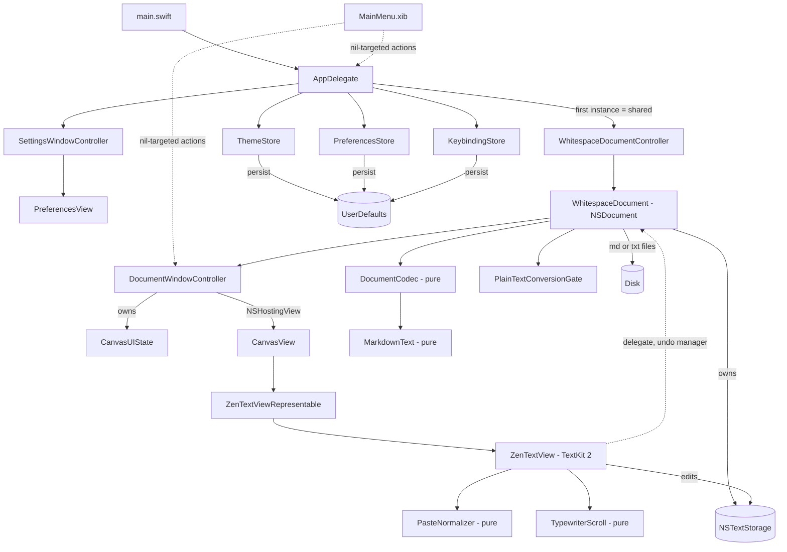

# Whitespace — Architecture

*Final document of the fable-review-1 engagement: Phase 1 audit (`a204d70`), Phase 2 refactors (R1–R8), Phase 3 markdown documents (P3.1–P3.8). Supersedes `ARCHITECTURE_REVIEW.md` and the Phase 3 plan (both in git history). Written for future development sessions, including AI sessions on weaker models: the conventions in §4 are rules, not suggestions. When this document and the code disagree, fix one of them in the same change.*

---

## 1. Structure

Whitespace is a single-target macOS writing app: an AppKit `NSDocument` shell around one substantial AppKit editor view, with SwiftUI views hosted inside it.

### Documents (data layer)

`WhitespaceDocument` (an `NSDocument` subclass) is the only document model. It owns an `NSTextStorage`, **the single source of truth**: the window's `ZenTextView` lays out and edits that storage directly. Styled runs and markdown exist only at read and save time. `read(from:ofType:)` decodes through `DocumentCodec` into the storage; `data(ofType:)` snapshots runs with `StyledRun.runs(in:)` and encodes them, nothing more. A user Save or Save As that would flatten formatting into plain text asks first, in `save(to:ofType:for:completionHandler:)`, through `PlainTextConversionGate` (§2). The type is `fileType`; a Save As that changes it switches the editor's formatting mode.

**Reading is UTF-8 only, and byte-exact or protected.** `DocumentCodec.decode` refuses anything that is not UTF-8 (`fileReadInapplicableStringEncoding`, with a reason NSDocument shows under its "could not be opened" line), keeps a BOM and uniform CRLF in `TextFileFormat` so the save writes them back, and reports `isLossless`: whether encoding what it decoded gives back the same bytes. A document read from a lossy file is **protected** (`isProtected`), in two layers:

- **Write refusal, the guarantee.** `writeSafely(to:ofType:for:)`, which every NSDocument write passes through, throws while the document is protected and the destination is its original file (compared by file identity, so a differently cased path counts). Save As or export elsewhere is allowed; a successful Save As ends protection, because the document now refers to a file it wrote.
- **Edit gate, the UX.** The document's `textView(_:shouldChangeTextIn:replacementString:)` refuses the first edit (typing, paste, ⌘B on a selection) and asks: Duplicate, Cancel, or Edit Anyway. Edit Anyway clears protection; the asking keystroke is dropped. Duplicate opens an untitled, unprotected copy holding the runs on screen (`duplicate()` sets them, because re-reading NSDocument's copy can come back different). Revert re-reads, so it restores protection.

The storage holds **faces only** (regular, bold, italic, bold-italic). Size, paragraph style and colour belong to the editor, which restyles the storage when it attaches and after any wholesale replacement.

NSDocument provides — natively, do not hand-roll any of these — untitled documents, save/Save As panels with the format picker, close/quit review sheets, autosave in place, unsaved-state restoration across relaunch, window-per-document, and Open Recent.

**Shell.** AppKit runs the lifecycle directly. `main.swift` sets `AppDelegate` and calls `NSApplicationMain`, which loads `MainMenu.xib` (the menu bar, nothing else). `AppDelegate.applicationWillFinishLaunching` registers the Crimson Pro faces **first** — faces are recognised by font name, so a read before registration flattens bold and italic silently — then instantiates `WhitespaceDocumentController`, which becomes `shared` and types untitled documents from the New Files preference. `applicationShouldOpenUntitledFile` is a real delegate method now and a cold launch lands on a blank page. Under XCTest the delegate opens no untitled window and neither saves nor restores window state, because the hosted test bundle launches the real app with the owner's bundle id.

`DocumentWindowController` builds each document window once: hidden title bar and traffic lights, `fullSizeContentView`, tabs disallowed, cascaded. As the window delegate it also owns fullscreen. It returns `FullscreenPresentation.options` (`[.fullScreen, .autoHideMenuBar, .autoHideDock]`) from `window(_:willUseFullScreenPresentationOptions:)`, so the menu bar and Dock stay out of sight but slide in at the screen edge and menus stay reachable by mouse. It also re-hides the traffic lights in `windowWillEnterFullScreen`, because fullscreen slides the title bar down with the menu bar. Both pin what macOS 27 already did on the owner's settings, measured on `main` before this change: AppKit proposed the same set, and the buttons hidden at creation stayed hidden. They make the behaviour ours rather than a system default that a setting or release could change. The set is fixed, not derived from AppKit's proposal: AppKit raises an exception for an invalid combination, and `FullscreenPresentation.isValid` encodes the documented rules, pinned by `FullscreenPresentationTests`. `.hideMenuBar` was tried and rejected: menus become unreachable by mouse, and in one trial an accessibility press of View ▸ Toggle Full Screen did not leave fullscreen. It hosts `CanvasView` in an `NSHostingView` and owns that window's `CanvasUIState`. `SettingsWindowController` hosts `PreferencesView` at the pane's designed size; Escape and ⌘, close it as well as ⌘W (⌘, brings it forward instead when it is behind a document window).

### Stores (state layer)

Three `@Observable @MainActor final class`es owned by `AppDelegate`, injected into the hosted SwiftUI views via `.environment()`:

| Store | Owns | Persistence |
|---|---|---|
| `PreferencesStore` | font size, line height, column width, scroll speed, overlay settings, new-document type | UserDefaults |
| `ThemeStore` | current/previous `Theme`, manual ~60 fps transition loop, color interpolation | UserDefaults |
| `KeybindingStore` | 6 customizable editor delete actions | UserDefaults (JSON `ShortcutBinding`) |

`CanvasUIState` (palette/overlay visibility) is **per-window**: each `DocumentWindowController` owns one and passes it to its `CanvasView`. The View menu's Command Palette and Shortcut Overlay items are nil-targeted, so the responder chain delivers them to the key window's controller only. Stores never import views and never reference each other directly.

### Views

`CanvasView` (per document window) = `GrainBackground` + centered `ZenTextViewRepresentable` + `CommandPaletteView` (an action palette: New/Open via `NSDocumentController` send-actions) + `ShortcutOverlayView`. `PreferencesView` lives in the Settings window. Window chrome is set once, when `DocumentWindowController` creates the window; nothing re-asserts it.

### Editor

`ZenTextView` (NSTextView subclass, TextKit 2) owns: typewriter scrolling (single scroll authority — `scrollRangeToVisible` routes through `recenter`), custom caret (`CursorBarView` + blink + system-indicator suppression), `keyDown` dispatch for non-menu chords, bold/italic in markdown mode (`formattingEnabled`), and paste normalization. `init(frame:textStorage:)` builds its TextKit 2 stack on the document's storage through `NSTextContentStorage.textStorage`.

A fresh editor is configured through one entry point, `setUp(...)`: **font, then colour**, applied to the content already in the storage. `applyFont` once replaced `typingAttributes` wholesale, so colour applied first was dropped and a document opened in the dark theme drew in black. It merges now (font and paragraph style only, everything else kept), and the order is kept so setup never depends on that. `restyleContent()` re-applies the last font and colour after a wholesale replacement. Pinned by `ZenTextViewSetUpTests`. Pure logic lives beside it:

- `TypewriterScroll.target(for:)` — scroll placement/deadzone decision

Typewriter centring depends on `textContainerInset.height` being **half the current viewport**, which is what puts the first line of an empty document in the middle of the screen. It must be driven by the scroll view's own `frameDidChangeNotification`, never by `NSWindow.didResizeNotification` alone: the window notification arrives before AppKit re-lays-out the scroll view. Measured entering fullscreen — the window already reported 1440 while `contentSize` was still 486, so the inset was computed from the old value and the first line sat at 17% of the screen, inside the top fade.

- `PasteNormalizer` — staged paste/drag normalization
- `MarkdownText` — markdown encode/decode of the text
- `DocumentCodec` — bytes ↔ runs for both types: UTF-8 check, BOM and line endings, the lossless check
- `StyledRun.runs(in:)` — the faithful storage → runs snapshot taken at save time (text verbatim; the app's faces mapped back to flags)

### Data flow for text

Keystroke → `ZenTextView` → the document's `NSTextStorage`. That is the whole path while writing: no per-keystroke extraction, no binding. NSDocument counts edits through the undo manager it shares with the editor (the document is the text view's delegate and answers `undoManager(for:)`), and autosaves in place. Save → `data(ofType:)` → `StyledRun.runs(in:)` → `DocumentCodec.encode` (markdown or plain text, in the file's own format). Open, revert and restoration → `read(from:ofType:)` → `DocumentCodec.decode` → `replaceContent(with:)`, which **must** keep the reset block together (§4.4).

## 2. The document dialect (normative)

| | `.md` (markdown) | `.txt` (plain) |
|---|---|---|
| ⌘B / ⌘I | Toggle bold/italic | **Silently inert** — no beep, no reaction (owner decision) |
| Paste | Keeps bold/italic, strips everything else | Strips all styling |
| On disk | `**bold**`, `*italic*`, `***both***`; prose `\`-escapes `` \ * _ ` [ < ~ ``, and `&` where it would start an entity (`&amp;`) | Exactly the characters on screen |
| Encoding | UTF-8, BOM kept if present; LF, or CRLF if the file used it | Same |
| `isRichText` | true | false |

Rules that must not regress:
- **The user never sees markdown syntax in a markdown document** — it is a storage format only.
- **Underline does not exist anywhere in the app.** `StyledRun` has no underline field; do not add one (markdown cannot express it).
- New documents default to `.md`; Settings ▸ Documents ▸ New Files switches the default (`whitespace.prefs.newDocumentType`). `WhitespaceDocumentController.defaultType` reads it; without the override AppKit would take the first Editor type in Info.plist, which is Plain Text. The save panel's format picker offers exactly Markdown Document and Plain Text (`writableTypes(for:)`), although the Plain Text document type lists three text UTIs for opening.
- Saving formatted content to `.plainText` triggers one warning via `PlainTextConversionGate` (suppression: `whitespace.prefs.suppressPlainTextConversionWarning`, resettable at Settings ▸ Documents ▸ Flatten Warning). **The gate asks before the save, never inside the write.** `WhitespaceDocument.save(to:ofType:for:completionHandler:)` asks `PlainTextConversionGate.shouldAsk(before:to:runs:defaults:)`, which says yes only for `.saveOperation` and `.saveAsOperation` (an allow-list, so autosaves, Save To and any operation AppKit adds later stay silent) to a non-markdown type with bold or italic and no suppression. The warning is a sheet on the window. The save is held, not aborted: Save Anyway carries on with the URL and type chosen in the save panel, and Cancel ends it with `userCancelled`, which NSDocument treats as quiet. Either way the completion handler runs exactly once; NSDocument queues every later save and autosave behind an unanswered one. NSDocument.h warns that a new activity begun during file access deadlocks; the sheet runs inside the save activity but before `super.save` starts file access, the same place the save panel runs. Do not reinstate the old abort-and-resume shape: throwing discards the destination chosen in the save panel, and the only way back in, re-sending `save:`, targets the document's existing URL and is a no-op outright on a clean document, so "Save Anyway" silently wrote nothing from P3.7 until 2026-07-27.
- After a successful user save to plain text the document drops bold and italic from its storage (`dropFormatting()`), so the window shows what the file holds. Faces are swapped in place, outside the undo manager and the change count, so selection, scroll and undo history survive and the document stays clean. Undo can still bring back text that was bold before the save: an autosave writes it flattened without asking, and the next Save or Save As asks again, as for any formatted content (`testUndoCanBringBoldBackAutosaveStaysQuietSaveAsks`).
- Dialect limits (accepted): only bold/italic round-trip; foreign markdown constructs (links, code spans, `_x_`, needless escapes like `\.`; block syntax is never interpreted) flatten to their visible text on load, and such a file is protected (§1) until the owner chooses. Trailing newlines survive (measured 2026-11-19; the old "dropped on first load" note no longer holds).
- Emphasis the encoder cannot express (accepted, guard-caught): bold → bold-italic → italic with no gap between (the `*` runs merge), and emphasis whose edge is punctuation touching a letter (`a**(b)**`). The encoder writes them, they read back differently, and the next open protects the file. Pinned by `testEmphasisTheEncoderCannotExpressIsCaughtByTheGuard`; everything else the encoder writes is lossless (`testOwnOutputIsLosslessForSeparatedEmphasis`).

## 3. What the engagement changed

| | Change |
|---|---|
| R1 | Undo enabled; undo stack cleared on wholesale content replacement |
| R2 | Dead command-layer code deleted (menu-duplicate `keyDown` branches never ran) |
| R3 | FileStore data-safety trio *(later superseded by NSDocument in P3.3)* |
| R4 | Palette/overlay real menu items; working palette keys; focus returns to editor |
| R5 | Auto-save policy into the store *(superseded by NSDocument autosave in P3.3)* |
| R6 | Scroll math extracted into `TypewriterScroll` with characterization tests |
| R7 | Keybinding Record button wired (NSEvent monitor, conflict surfacing) |
| R8 | Local cleanups; panel ink into `Theme`; first `ARCHITECTURE.md` |
| P3.1–2 | `MarkdownText` encoder/decoder, round-trip tested |
| P3.3 | NSDocument architecture adopted (`feat/nsdocument-markdown` reconciled; FileStore/FileBuffer retired) |
| P3.4 | Documents carry `[StyledRun]`; editor syncs attributed content |
| P3.5 | Per-type editor modes; underline removed app-wide |
| P3.6 | New-file type preference (.md default) |
| P3.7 | Plain-text conversion warning with suppression |
| Shell | `DocumentGroup` replaced by an owned `NSDocument` shell: document-owned text storage, AppKit lifecycle, window controllers, `MainMenu.xib`; dark-launch colour fixed (2026-11-18) |
| Codec | `DocumentCodec`: UTF-8 only (Latin-1 fallback deleted), BOM and CRLF kept, lossy files protected from overwrite; typed entities escaped (2026-11-19) |

## 4. Conventions for new code (rules)

1. **New shared state** = `@Observable @MainActor final class`, UserDefaults injected through `init(defaults:)` for testability, keys namespaced `whitespace.<area>.<name>`. No singletons, no Combine, no protocol-for-one-implementation.
2. **New command/shortcut**: add a real menu item — that is the single dispatch point for any chord a menu can express. Never add a disabled placeholder menu item. Never duplicate a menu chord in `keyDown` (dead code; the menu intercepts first). `keyDown` is only for chords menus can't own (⌘B/⌘I/⌘+/⌘− and `KeybindingStore` lookups). Menu items live in `MainMenu.xib` with nil-targeted actions: window state is reached through the responder chain (`DocumentWindowController`), app state through `AppDelegate` — never a shared app-wide UI-state object. The menu bar is hand-built, so nothing appears for free: diff it against the previous menu (accessibility dump) when changing it. A ⌃⌘F key equivalent declared in the nib is rewritten by AppKit to the Globe key, so the two full-screen chords are assigned in `applicationDidFinishLaunching`. When adding an app-level shortcut, also update `ShortcutOverlayView.appShortcuts`.
3. **Keyboard handling in SwiftUI overlays**: `.onKeyPress`/`.onMoveCommand`/`.onExitCommand` do NOT fire while an AppKit field editor has focus. Use the `CommandPaletteView` patterns: `.onSubmit` for Return, invisible `Button` + bare `.keyboardShortcut` for arrows, local `NSEvent` monitor (installed `onAppear`, removed `onDisappear`) for Escape.
4. **Wholesale content replacement** goes only through `WhitespaceDocument.replaceContent(with:)`, which keeps the reset block together: `invalidateScrollAnchor()` → `undoManager?.removeAllActions()` → rebuild the storage's faces via `PasteNormalizer.attributedString(runs:baseAttributes:)` → `restyleContent()`. Breaking it up reintroduces stale-anchor scrolling, cross-document undo, or unstyled text.
5. **Document I/O**: serialization lives in `DocumentCodec`/`MarkdownText` (pure, testable), and any change to it comes with a byte-exact round-trip test; `read(from:ofType:)` and `data(ofType:)` stay thin and UI-free. `read` is nonisolated in the SDK but runs on main (`canConcurrentlyReadDocuments` is false), hence `MainActor.assumeIsolated`. Edit counting: NSDocument counts edits registered with the undo manager; only paths that register none call `updateChangeCount(.changeDone)` (today: attribute-only edits, recognised by a nil replacement string in the delegate). Counting every change would double-count and the document would never return to clean. Every save breaks the editor's typing coalescing (`WhitespaceDocument.save(to:ofType:for:completionHandler:)`); without it, typing that continues after a save registers no new undo group and is never counted. Anything destructive at save time asks at the save operation, before `super.save` (see `PlainTextConversionGate` and §2), never with a dialog inside `data(ofType:)` or the write; the held save must call its completion handler exactly once on every path. NSDocument class properties AppKit reads during a save (`preservesVersions`) must be `nonisolated`: AppKit reads some on a background queue after an in-place write, and a main-actor override traps there. A new write path must reach `writeSafely(to:ofType:for:)`, where the protected-file refusal lives; a new edit path must go through `shouldChangeText`, where the edit gate lives.
6. **Editor logic** that is decision-shaped (geometry, classification, normalization, serialization) lives in a pure type with value inputs and unit tests — `TypewriterScroll`, `PasteNormalizer`, `MarkdownText` are the exemplars. TK2/AppKit calls stay in the view; decisions move out.
7. **Tests**: XCTest; stores with `UserDefaults(suiteName:)` + domain wipe in tearDown; `ZenTextView` behavior via offscreen `NSWindow` hosting (`ZenTextViewUndoTests`); document behaviour through the real window (`makeWindowControllers()`, see `WhitespaceDocumentShellTests`). Typing opens an undo group that only the app's event loop closes, so tests close it before asserting the change count. Any document a test edits gets a temporary file URL and is closed in teardown: an edited untitled document would autosave into the owner's real Autosave Information, which the test host shares. For the same reason `WhitespaceDocument.preservesVersions` is off under XCTest: saving a file in the temporary folder otherwise leaves a `.genstore.noindex` version store in that folder on every run; `keyDown` via constructed `NSEvent.keyEvent` chords; round-trip tests for any serialization. **Offscreen hosting cannot reproduce TK2 stale-layout bugs** — it settles layout synchronously, so anything that depends on the viewport layout pass (caret baseline, recentering) passes with or without the fix. Measured in `ZenTextViewCaretBaselineTests`: reverting the fix, and forcing `invalidateLayout(for:)` before the read, both still passed. Write those tests as characterization and verify the actual behavior on screen. **Never assert on an animated result either** — `animator().setBoundsOrigin` does not commit while the display is asleep, so a suite that checks the scrolled position turns red overnight with numbers identical to a real regression. Assert the decision (`currentScrollTarget`) and let AppKit own applying it.
8. **Adding files**: the pbxproj and `Info.plist` are generated — run `xcodegen generate` after creating a file; declare Info.plist keys (document types, UTIs) in `project.yml`. Never edit either artifact by hand.
9. **Definition of done**: clean build + full suite green (`xcodebuild -project Whitespace.xcodeproj -scheme Whitespace -destination 'platform=macOS' test`) + for UI changes, the behavior observed in the running app. One concern per commit.
10. **Product philosophy**: read `DESIGN.md` before adding any UI. No visible chrome in the writing surface, no color-as-affordance. If a feature's value is "lets the user fiddle with presentation," it is the wrong feature.
11. **Verifying UI on this machine**: synthetic keystrokes are unreliable (keyboard remappers) — prefer AX menu clicks and `key code N` over `keystroke`; read state via accessibility values; screen capture requires the display awake.

## 5. Deliberate debt and open items

**No longer reproduces — the Settings window exposed no accessibility elements.** Recorded earlier as zero elements over the accessibility API. Re-checked 2026-11-18 on both the old shell and the new `SettingsWindowController`: 36 elements each, every control reachable. Cause of the earlier reading unknown; re-check if assistive tooling reports it again.

**Open gap — ⌘B is not independently undoable.** AppKit records no attribute-restoring action for `shouldChangeText(in:replacementString: nil)` under TextKit 2, so ⌘Z after a formatting change unwinds the typing rather than the formatting. Pre-existing and separate from the propagation fix below; pinned by `testFormattingIsNotYetIndependentlyUndoable` so the day it changes, that test fails and gets updated. Fixing it means registering the old attributed substring with the undo manager by hand.

**Fixed 2026-11-18 — documents opened in the dark theme drew in black.** `makeNSView` applied colours, then `applyFont` replaced `typingAttributes` wholesale, dropping the foreground colour, and the content was built from those attributes. Fixed in the shell move by the single `setUp` entry point (font → colour); see §1 Editor. ⌘+/⌘− had the same cause: text typed after them lost the colour until the next theme change. Fixed 2026-11-19 by making `applyFont` merge into `typingAttributes`; pinned by the two font-size tests in `ZenTextViewSetUpTests` (an empty document included, where no neighbouring character supplies a colour) and seen on screen in the Debug build. The same replacement reset the typing face to regular, so a size change while ⌘B or ⌘I was armed for new typing dropped the bold or italic; observed by the owner 2026-11-20. `applyFont` now keeps the armed face at the new size; pinned by `testArmedFaceSurvivesAFontSizeChange`.

**Fixed 2026-11-21 — the caret blinked out of place on ⌘+/⌘−.** Reported by the owner 2026-11-20: with the wrong timing, a size change drew the caret at a wrong position for one blink. `applyFont` restyles the storage without an edit or a selection change, so nothing repainted the drawn caret (`cursorView`), and it stayed where the old size put it until the next blink tick, up to 0.53 s. Present since before the colour fix, which left the restyle untouched. `applyFont` now ends with `resetCursorBlink()`, the same immediate-plus-next-runloop repaint typing uses. Pinned by the two `testDrawnCaretFollowsAFontSizeChange` tests, through the internal `displayedCursorFrame`; like the rest of `ZenTextViewCaretBaselineTests` they can't see on-screen timing, only that the repaint is asked for.

**Fixed 2026-11-21 — `dropFormatting()` had the same gap.** After a plain-text save it swaps bold and italic faces in place, which narrows the text, and nothing repainted the caret, so it sat stale for up to one blink. Found by reading the code; `testDrawnCaretFollowsTheDroppedFormatting` measured it (the drawn caret 5 pt right of the text's end) and failed before the fix. It now ends with `resetCursorBlink()`, as `applyFont` does. Measured in a test; not yet seen on screen.

**Fixed 2026-11-18 — typing after a save was never counted.** Found during the shell move: NSTextView coalesces consecutive typing into one undo action, and AppKit opens an undo group only when something registers, so a keystroke continuing after an autosave joined the action from before it. NSDocument saw no edit, never autosaved again, and would close without asking. Every save now calls `breakUndoCoalescing()`. Pinned by `testASaveBreaksTypingCoalescing`, which checks the coalescing state because tests have no event loop to group by event.

**Fixed 2026-11-21 — kill-line skipped the change contract.** `killLine()` edited the storage with `NSText.replaceCharacters`, skipping `shouldChangeText`/`didChangeText`. On a protected document it changed the text without asking; it registered no undo, so ⌘Z couldn't bring the text back, the document never turned dirty, and closing discarded the kill silently (observed 2026-11-19; the original file stayed byte-identical). It now edits through the contract like the paste path: the gate asks, and the kill is its own undo step. The kill registers with the undo manager (`testKillLineRegistersWithTheUndoManager`), which is what NSDocument counts. The change count itself can't be checked in a test: it moves when an event's undo group closes, which needs a real event loop. The other five delete keybindings use NSTextView's own delete methods and already honoured the contract; `testEveryDeleteKeybindingIsUndoable` and `testEveryDeleteKeybindingAsks` loop over every `KeybindingAction` so a new one is covered too. Kill-line's range is the rest of the line *including* its newline (`lineRange`), so a kill mid-line also joins the next line on. Seen in a saved file 2026-11-21. macOS's own ⌃K stops before the newline. Kept on purpose (owner, 2026-11-21): in prose most lines on screen are soft wraps, not line breaks, so this isn't a code editor's line kill.

**Fixed 2026-11-19 — autosave re-asked after Save Anyway to `.txt`.** The warning ran inside `data(ofType:)`, so every write asked, autosaves included; after Save Anyway the storage still held bold, the next autosave (about 30 s after an edit) raised the warning again, and Cancel there left the edit unsaved. Measured on `main` before the fix. The gate now asks only for a user Save or Save As, before the write, and the storage drops its formatting after a plain-text save. Pinned by `PlainTextConversionGateTests`.

**Fixed 2026-11-19 — Save crashed after an in-place write.** `WhitespaceDocument.preservesVersions` was main-actor isolated; AppKit reads it on a background queue once an in-place save has written the file, so Swift's isolation check trapped and the app crashed on every Save of an edited file, just after the bytes reached disk. Present since the shell move, found while checking the flatten gate live; the suite missed it because nothing read the property off the main thread. Pinned by `testPreservesVersionsCanBeReadOffTheMainThread`, which crashes the test host without the fix.

**Fixed 2026-07-27 — ⌘B/⌘I on a selection never reached the document.** `applyFontVariant` mutated the text storage directly, skipping `shouldChangeText`/`didChangeText`, so the delegate never fired, `currentStyledRuns()` never ran, and the document's runs stayed plain. The bold rendered on screen and existed nowhere else: absent from the save, absent from the flatten warning's formatting check, and the document not even marked dirty. (Since the shell move the storage is the document, so the bold always reaches the save; the change contract still matters for undo grouping and for the dirty mark.) Present since P3.4. It hid because the only coverage pressed ⌘B with *no selection* and then typed — `insertText` fires `didChangeText` for its own reasons, so that path always worked. **Any attribute-only edit must go through the change contract.**

**Fixed 2026-07-26 — typewriter recentering didn't follow sustained typing.** Cause: `caretCenterTargetY` required `textLayoutFragment(for:)`, which TK2 returns as nil at end-of-text — exactly where the caret sits while drafting. No fragment meant no scroll target, so the viewport stayed pinned and the caret walked off the bottom. The decision math was never at fault, and neither was the `currentScrollTarget` cache; both suspects are cleared. The end-of-text fallback now lives in one place, `layoutFragment(atOrBefore:)`, shared by all three caret-geometry paths. Covered by `TypewriterRecenterTests` (reverting the fallback puts the caret at 126% of the viewport).

**Scroll animation duration — a known limit, deliberately unchanged.** `kineticDuration` floors at 0.68s at every distance, so a one-line move still animates for 0.68s and each keystroke restarts it. Measured: harmless at any realistic rate (lines every 0.35s and 1.4s, continuous prose at 20 insertions/sec all hold the caret near 50%), but at ~50 lines/sec the deficit compounds until the caret leaves the viewport. Lowering the floor would change the tuned feel of every scroll, so it waits on owner judgement.

**Verified live 2026-11-19, fullscreen chrome** — in the Debug build on a 14″ notched display, with the owner's settings: menu bar shown on the desktop and hidden in fullscreen, Dock auto-hiding. `main` already looked the same in fullscreen: AppKit proposed `[.fullScreen, .autoHideMenuBar, .autoHideDock]`, and no traffic lights appeared at rest or at the top edge. So the change makes no visible difference here; it pins that behaviour. With the change: at rest there is no menu bar and there are no traffic lights. At the top edge the menu bar slides in and its menus work; no traffic lights appear. The traffic lights are still hidden after exit. The first line of an empty document sat at 52% of the screen height in fullscreen and 51% of the window after exit. Screenshots in `docs/screenshots/2026-11-19-fullscreen/`.

**Verified live 2026-11-19, after the gate moved before the write** — the P3.7 matrix re-run in the Debug build: the warning arrives as a sheet after the save panel closes; Cancel writes no file and keeps the bold and the `.md`; Save Anyway writes flattened bytes and the window drops its bold; an edit after that autosaves in place about 30 s later with no prompt; a ticked suppression box persists across a relaunch; an unformatted file is never asked. Screenshots in `docs/screenshots/2026-11-19-flatten-gate/`.

**Verified live 2026-07-27** — the P3.7 conversion matrix: warns once, Cancel aborts leaving no file, **Save Anyway writes flattened bytes** (this was broken from P3.7 until that date — see §2), suppression persists and still honours the clicked button, unformatted content is never asked. Only Settings ▸ Documents ▸ Flatten Warning is unconfirmed on screen; its logic is covered by `PreferencesStoreTests`. P3.6's save-sheet default was owner-verified.

**Kept as-is, on purpose:**
- **Panel ink is now dimmer than body text in dark mode.** `panelInkColor` (`#7D6D6C`, 3.82:1) was chosen to sit *brighter* than the old `textColor` (`#6B5B5E`, 2.93:1) so the shortcuts panel read against the page; its doc comment still says so. Raising text to `#988888` (5.55:1) inverted that relationship. The panel is a transient overlay so it is not urgent, but either the colour or the comment is now wrong — owner call, since it is a taste value.
- Shortcut-overlay right padding is still `geo.size.width / 18` — 50pt at 900 wide, 140pt at 2560. Checked against a real fullscreen capture and it reads correctly, so it was left proportional rather than re-tuned blind.
- Column width tops out at 820pt (`medium` is 680), so fullscreen at 2560 leaves ~900pt of margin per side. Verified centered and correct; whether that reads as generous or lost is an owner call.
- Open Recent is wired (`systemMenu="recentDocuments"` in `MainMenu.xib`; a code-built submenu only fills through a private AppKit call) but cannot be observed on the owner's Mac, where System Settings keeps no recent items. Verified on a scratch bundle id with a recent-documents limit set.
- In fullscreen, the menu bar's top-edge reveal brings down AppKit's empty title-bar strip under it: a faint band with no buttons, gone when the pointer leaves. It was there before the fullscreen change too. It is the system's fullscreen title bar, and removing it would mean fighting AppKit's fullscreen window, so it stays unless the owner finds it distracting.
- First render of loaded content can flash dimmed momentarily; document proxy-icon ghost faintly visible top-left — cosmetic.
- Re-saving formatted content as `.txt` without suppression warns on every save — matches "warn per destructive save"; revisit if it annoys.
- Full-storage `foregroundColor` repaint ~94×/theme toggle — imperceptible at prose scale; revisit only with profiling evidence.
- `try?`/silent failure on some I/O paths — NSDocument surfaces most errors natively now; remaining gaps acceptable.
- Brute-force insertion-indicator suppression (view-tree walk + class-name matching) — fragile by necessity against TK2's private indicator; re-verify after macOS updates.
- Manual ~60 fps theme-transition Task loop; mid-transition toggle jump (rapid double-toggle only) — documented at `ThemeStore.set`.
- `ShortcutBinding.displayString` renders some keyCodes oddly under keyboard remappers (UCKeyTranslate quirk) — environmental; the data layer is correct.
