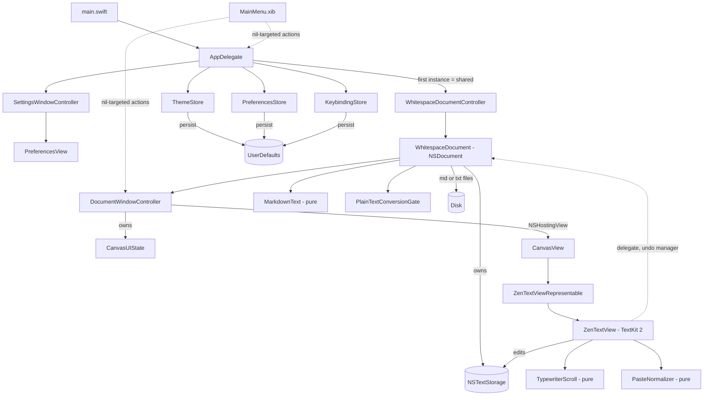

# Whitespace — Architecture

*Final document of the fable-review-1 engagement: Phase 1 audit (`a204d70`), Phase 2 refactors (R1–R8), Phase 3 markdown documents (P3.1–P3.8). Supersedes `ARCHITECTURE_REVIEW.md` and the Phase 3 plan (both in git history). Written for future development sessions, including AI sessions on weaker models: the conventions in §4 are rules, not suggestions. When this document and the code disagree, fix one of them in the same change.*

---

## 1. Structure

Whitespace is a single-target macOS writing app: an AppKit `NSDocument` shell around one substantial AppKit editor view, with SwiftUI views hosted inside it.

### Documents (data layer)

`WhitespaceDocument` (an `NSDocument` subclass) is the only document model. It owns an `NSTextStorage`, **the single source of truth**: the window's `ZenTextView` lays out and edits that storage directly. Styled runs and markdown exist only at read and save time. `read(from:ofType:)` decodes through `MarkdownText` into the storage; `data(ofType:)` snapshots runs with `StyledRun.runs(in:)` and encodes them, consulting `PlainTextConversionGate` before any write that would flatten formatting. The type is `fileType`; a Save As that changes it switches the editor's formatting mode.

The storage holds **faces only** (regular, bold, italic, bold-italic). Size, paragraph style and colour belong to the editor, which restyles the storage when it attaches and after any wholesale replacement.

NSDocument provides — natively, do not hand-roll any of these — untitled documents, save/Save As panels with the format picker, close/quit review sheets, autosave in place, unsaved-state restoration across relaunch, window-per-document, and Open Recent.

**Shell.** AppKit runs the lifecycle directly. `main.swift` sets `AppDelegate` and calls `NSApplicationMain`, which loads `MainMenu.xib` (the menu bar, nothing else). `AppDelegate.applicationWillFinishLaunching` registers the Crimson Pro faces **first** — faces are recognised by font name, so a read before registration flattens bold and italic silently — then instantiates `WhitespaceDocumentController`, which becomes `shared` and types untitled documents from the New Files preference. `applicationShouldOpenUntitledFile` is a real delegate method now and a cold launch lands on a blank page. Under XCTest the delegate opens no untitled window and neither saves nor restores window state, because the hosted test bundle launches the real app with the owner's bundle id.

`DocumentWindowController` builds each document window once: hidden title bar and traffic lights, `fullSizeContentView`, tabs disallowed, cascaded. It hosts `CanvasView` in an `NSHostingView` and owns that window's `CanvasUIState`. `SettingsWindowController` hosts `PreferencesView` at the pane's designed size.

### Stores (state layer)

Three `@Observable @MainActor final class`es owned by `AppDelegate`, injected into the hosted SwiftUI views via `.environment()`:

| Store | Owns | Persistence |
|---|---|---|
| `PreferencesStore` | font size, line height, column width, scroll speed, overlay settings, new-document type | UserDefaults |
| `ThemeStore` | current/previous `Theme`, manual ~60 fps transition loop, color interpolation | UserDefaults |
| `KeybindingStore` | 6 customizable editor delete actions | UserDefaults (JSON `ShortcutBinding`) |

`CanvasUIState` (palette/overlay visibility) is **per-window**: each `DocumentWindowController` owns one and passes it to its `CanvasView`. The View menu's Command Palette and Shortcut Overlay items are nil-targeted, so the responder chain delivers them to the key window's controller only. Stores never import views and never reference each other directly.

### Views

`CanvasView` (per document window) = `GrainBackground` + centered `ZenTextViewRepresentable` + `CommandPaletteView` (an action palette: New/Open via `NSDocumentController` send-actions) + `ShortcutOverlayView`. `PreferencesView` lives in the Settings window. Window chrome is set once, when `DocumentWindowController` creates the window; nothing re-asserts it.

### Editor

`ZenTextView` (NSTextView subclass, TextKit 2) owns: typewriter scrolling (single scroll authority — `scrollRangeToVisible` routes through `recenter`), custom caret (`CursorBarView` + blink + system-indicator suppression), `keyDown` dispatch for non-menu chords, bold/italic in markdown mode (`formattingEnabled`), and paste normalization. `init(frame:textStorage:)` builds its TextKit 2 stack on the document's storage through `NSTextContentStorage.textStorage`.

A fresh editor is configured through one entry point, `setUp(...)`: **font, then colour**, applied to the content already in the storage. The order matters because `applyFont` replaces `typingAttributes` wholesale; colour applied first was dropped, and a document opened in the dark theme drew in black. `restyleContent()` re-applies the last font and colour after a wholesale replacement. Pinned by `ZenTextViewSetUpTests`. Pure logic lives beside it:

- `TypewriterScroll.target(for:)` — scroll placement/deadzone decision

Typewriter centring depends on `textContainerInset.height` being **half the current viewport**, which is what puts the first line of an empty document in the middle of the screen. It must be driven by the scroll view's own `frameDidChangeNotification`, never by `NSWindow.didResizeNotification` alone: the window notification arrives before AppKit re-lays-out the scroll view. Measured entering fullscreen — the window already reported 1440 while `contentSize` was still 486, so the inset was computed from the old value and the first line sat at 17% of the screen, inside the top fade.

- `PasteNormalizer` — staged paste/drag normalization
- `MarkdownText` — markdown encode/decode (the document's serialization)
- `StyledRun.runs(in:)` — the faithful storage → runs snapshot taken at save time (text verbatim; the app's faces mapped back to flags)

### Data flow for text

Keystroke → `ZenTextView` → the document's `NSTextStorage`. That is the whole path while writing: no per-keystroke extraction, no binding. NSDocument counts edits through the undo manager it shares with the editor (the document is the text view's delegate and answers `undoManager(for:)`), and autosaves in place. Save → `data(ofType:)` → `StyledRun.runs(in:)` → `MarkdownText.encode` or plain text. Open, revert and restoration → `read(from:ofType:)` → `replaceContent(with:)`, which **must** keep the reset block together (§4.4).

## 2. The document dialect (normative)

| | `.md` (markdown) | `.txt` (plain) |
|---|---|---|
| ⌘B / ⌘I | Toggle bold/italic | **Silently inert** — no beep, no reaction (owner decision) |
| Paste | Keeps bold/italic, strips everything else | Strips all styling |
| On disk | `**bold**`, `*italic*`, `***both***`; prose `\`-escapes `` \ * _ ` [ < ~ `` | Exactly the characters on screen |
| `isRichText` | true | false |

Rules that must not regress:
- **The user never sees markdown syntax in a markdown document** — it is a storage format only.
- **Underline does not exist anywhere in the app.** `StyledRun` has no underline field; do not add one (markdown cannot express it).
- New documents default to `.md`; Settings ▸ Documents ▸ New Files switches the default (`whitespace.prefs.newDocumentType`). `WhitespaceDocumentController.defaultType` reads it; without the override AppKit would take the first Editor type in Info.plist, which is Plain Text. The save panel's format picker offers exactly Markdown Document and Plain Text (`writableTypes(for:)`), although the Plain Text document type lists three text UTIs for opening.
- Saving formatted content to `.plainText` triggers one warning via `PlainTextConversionGate` (suppression: `whitespace.prefs.suppressPlainTextConversionWarning`, resettable at Settings ▸ Documents ▸ Flatten Warning). **The gate asks during the write and blocks on the answer.** NSDocument calls `data(ofType:)` on the main thread (writes are not asynchronous), so the alert runs modally inside the write; approve falls through, cancel throws `userCancelled`. The gate's off-main `DispatchQueue.main.sync` branch is left from the SwiftUI shell and goes when the gate moves before the write. Do not reinstate the old abort-and-resume shape: throwing discards the destination chosen in the save panel, and the only way back in — re-sending `save:` — targets the document's existing URL and is a no-op outright on a clean document, so "Save Anyway" silently wrote nothing from P3.7 until 2026-07-27.
- Dialect limits (accepted): only bold/italic round-trip; foreign markdown constructs (links, code spans; block syntax is never interpreted) flatten to their visible text on load; a file's single trailing newline is dropped on first load (stable thereafter).

## 3. What the engagement changed

| | Change |
|---|---|
| R1 | Undo enabled; undo stack cleared on wholesale content replacement |
| R2 | Dead command-layer code deleted (menu-duplicate `keyDown` branches never ran) |
| R3 | FileStore data-safety trio *(later superseded by NSDocument in P3.3)* |
| R4 | Palette/overlay real menu items; working palette keys; focus returns to editor |
| R5 | Auto-save policy into the store *(superseded by NSDocument autosave in P3.3)* |
| R6 | Scroll math extracted into `TypewriterScroll` with characterization tests |
| R7 | Keybinding Record button wired (NSEvent monitor, conflict surfacing) |
| R8 | Local cleanups; panel ink into `Theme`; first `ARCHITECTURE.md` |
| P3.1–2 | `MarkdownText` encoder/decoder, round-trip tested |
| P3.3 | NSDocument architecture adopted (`feat/nsdocument-markdown` reconciled; FileStore/FileBuffer retired) |
| P3.4 | Documents carry `[StyledRun]`; editor syncs attributed content |
| P3.5 | Per-type editor modes; underline removed app-wide |
| P3.6 | New-file type preference (.md default) |
| P3.7 | Plain-text conversion warning with suppression |
| Shell | `DocumentGroup` replaced by an owned `NSDocument` shell: document-owned text storage, AppKit lifecycle, window controllers, `MainMenu.xib`; dark-launch colour fixed (2026-11-18) |

## 4. Conventions for new code (rules)

1. **New shared state** = `@Observable @MainActor final class`, UserDefaults injected through `init(defaults:)` for testability, keys namespaced `whitespace.<area>.<name>`. No singletons (the conversion gate's static one-shot flag is the lone, documented exception), no Combine, no protocol-for-one-implementation.
2. **New command/shortcut**: add a real menu item — that is the single dispatch point for any chord a menu can express. Never add a disabled placeholder menu item. Never duplicate a menu chord in `keyDown` (dead code; the menu intercepts first). `keyDown` is only for chords menus can't own (⌘B/⌘I/⌘+/⌘− and `KeybindingStore` lookups). Menu items live in `MainMenu.xib` with nil-targeted actions: window state is reached through the responder chain (`DocumentWindowController`), app state through `AppDelegate` — never a shared app-wide UI-state object. The menu bar is hand-built, so nothing appears for free: diff it against the previous menu (accessibility dump) when changing it. A ⌃⌘F key equivalent declared in the nib is rewritten by AppKit to the Globe key, so the two full-screen chords are assigned in `applicationDidFinishLaunching`. When adding an app-level shortcut, also update `ShortcutOverlayView.appShortcuts`.
3. **Keyboard handling in SwiftUI overlays**: `.onKeyPress`/`.onMoveCommand`/`.onExitCommand` do NOT fire while an AppKit field editor has focus. Use the `CommandPaletteView` patterns: `.onSubmit` for Return, invisible `Button` + bare `.keyboardShortcut` for arrows, local `NSEvent` monitor (installed `onAppear`, removed `onDisappear`) for Escape.
4. **Wholesale content replacement** goes only through `WhitespaceDocument.replaceContent(with:)`, which keeps the reset block together: `invalidateScrollAnchor()` → `undoManager?.removeAllActions()` → rebuild the storage's faces via `PasteNormalizer.attributedString(runs:baseAttributes:)` → `restyleContent()`. Breaking it up reintroduces stale-anchor scrolling, cross-document undo, or unstyled text.
5. **Document I/O**: serialization lives in `MarkdownText`/`encodedData` (pure, testable); `read(from:ofType:)` and `data(ofType:)` stay thin and UI-free. `read` is nonisolated in the SDK but runs on main (`canConcurrentlyReadDocuments` is false), hence `MainActor.assumeIsolated`. Edit counting: NSDocument counts edits registered with the undo manager; only paths that register none call `updateChangeCount(.changeDone)` (today: attribute-only edits, recognised by a nil replacement string in the delegate). Counting every change would double-count and the document would never return to clean. Anything destructive at write time goes through a gate (see `PlainTextConversionGate`), never a dialog in the write path.
6. **Editor logic** that is decision-shaped (geometry, classification, normalization, serialization) lives in a pure type with value inputs and unit tests — `TypewriterScroll`, `PasteNormalizer`, `MarkdownText` are the exemplars. TK2/AppKit calls stay in the view; decisions move out.
7. **Tests**: XCTest; stores with `UserDefaults(suiteName:)` + domain wipe in tearDown; `ZenTextView` behavior via offscreen `NSWindow` hosting (`ZenTextViewUndoTests`); document behaviour through the real window (`makeWindowControllers()`, see `WhitespaceDocumentShellTests`). Typing opens an undo group that only the app's event loop closes, so tests close it before asserting the change count. Any document a test edits gets a temporary file URL and is closed in teardown: an edited untitled document would autosave into the owner's real Autosave Information, which the test host shares; `keyDown` via constructed `NSEvent.keyEvent` chords; round-trip tests for any serialization. **Offscreen hosting cannot reproduce TK2 stale-layout bugs** — it settles layout synchronously, so anything that depends on the viewport layout pass (caret baseline, recentering) passes with or without the fix. Measured in `ZenTextViewCaretBaselineTests`: reverting the fix, and forcing `invalidateLayout(for:)` before the read, both still passed. Write those tests as characterization and verify the actual behavior on screen. **Never assert on an animated result either** — `animator().setBoundsOrigin` does not commit while the display is asleep, so a suite that checks the scrolled position turns red overnight with numbers identical to a real regression. Assert the decision (`currentScrollTarget`) and let AppKit own applying it.
8. **Adding files**: the pbxproj and `Info.plist` are generated — run `xcodegen generate` after creating a file; declare Info.plist keys (document types, UTIs) in `project.yml`. Never edit either artifact by hand.
9. **Definition of done**: clean build + full suite green (`xcodebuild -project Whitespace.xcodeproj -scheme Whitespace -destination 'platform=macOS' test`) + for UI changes, the behavior observed in the running app. One concern per commit.
10. **Product philosophy**: read `DESIGN.md` before adding any UI. No visible chrome in the writing surface, no color-as-affordance. If a feature's value is "lets the user fiddle with presentation," it is the wrong feature.
11. **Verifying UI on this machine**: synthetic keystrokes are unreliable (keyboard remappers) — prefer AX menu clicks and `key code N` over `keystroke`; read state via accessibility values; screen capture requires the display awake.

## 5. Deliberate debt and open items

**Open gap — the Settings window exposes no accessibility elements.** `entire contents` of `Whitespace Settings` returns zero elements over the accessibility API, so VoiceOver and any assistive tooling cannot reach a single control; document windows expose their text areas normally. Suspect the custom window styling (transparent titlebar, `fullSizeContentView`, clear background — now set in `SettingsWindowController`) combined with `.ultraThinMaterial`. Not re-checked after the shell move; not investigated further — noted because it is an accessibility defect, not a cosmetic one.

**Open gap — ⌘B is not independently undoable.** AppKit records no attribute-restoring action for `shouldChangeText(in:replacementString: nil)` under TextKit 2, so ⌘Z after a formatting change unwinds the typing rather than the formatting. Pre-existing and separate from the propagation fix below; pinned by `testFormattingIsNotYetIndependentlyUndoable` so the day it changes, that test fails and gets updated. Fixing it means registering the old attributed substring with the undo manager by hand.

**Fixed 2026-11-18 — documents opened in the dark theme drew in black.** `makeNSView` applied colours, then `applyFont` replaced `typingAttributes` wholesale, dropping the foreground colour, and the content was built from those attributes. Fixed in the shell move by the single `setUp` entry point (font → colour); see §1 Editor. ⌘+/⌘− still replace `typingAttributes`, so text typed after them loses the colour until the next theme change: open, fixed next.

**Open — autosave re-asks after Save Anyway to `.txt`.** Observed on both shells: after Save As plain text with Save Anyway, the storage still holds bold, so the next autosave raises the flatten warning again. Belongs to moving the gate before the write.

**Fixed 2026-07-27 — ⌘B/⌘I on a selection never reached the document.** `applyFontVariant` mutated the text storage directly, skipping `shouldChangeText`/`didChangeText`, so the delegate never fired, `currentStyledRuns()` never ran, and the document's runs stayed plain. The bold rendered on screen and existed nowhere else: absent from the save, absent from the flatten warning's formatting check, and the document not even marked dirty. (Since the shell move the storage is the document, so the bold always reaches the save; the change contract still matters for undo grouping and for the dirty mark.) Present since P3.4. It hid because the only coverage pressed ⌘B with *no selection* and then typed — `insertText` fires `didChangeText` for its own reasons, so that path always worked. **Any attribute-only edit must go through the change contract.**

**Fixed 2026-07-26 — typewriter recentering didn't follow sustained typing.** Cause: `caretCenterTargetY` required `textLayoutFragment(for:)`, which TK2 returns as nil at end-of-text — exactly where the caret sits while drafting. No fragment meant no scroll target, so the viewport stayed pinned and the caret walked off the bottom. The decision math was never at fault, and neither was the `currentScrollTarget` cache; both suspects are cleared. The end-of-text fallback now lives in one place, `layoutFragment(atOrBefore:)`, shared by all three caret-geometry paths. Covered by `TypewriterRecenterTests` (reverting the fallback puts the caret at 126% of the viewport).

**Scroll animation duration — a known limit, deliberately unchanged.** `kineticDuration` floors at 0.68s at every distance, so a one-line move still animates for 0.68s and each keystroke restarts it. Measured: harmless at any realistic rate (lines every 0.35s and 1.4s, continuous prose at 20 insertions/sec all hold the caret near 50%), but at ~50 lines/sec the deficit compounds until the caret leaves the viewport. Lowering the floor would change the tuned feel of every scroll, so it waits on owner judgement.

**Verified live 2026-07-27** — the P3.7 conversion matrix: warns once, Cancel aborts leaving no file, **Save Anyway writes flattened bytes** (this was broken from P3.7 until that date — see §2), suppression persists and still honours the clicked button, unformatted content is never asked. Only Settings ▸ Documents ▸ Flatten Warning is unconfirmed on screen; its logic is covered by `PreferencesStoreTests`. P3.6's save-sheet default was owner-verified.

**Kept as-is, on purpose:**
- **Panel ink is now dimmer than body text in dark mode.** `panelInkColor` (`#7D6D6C`, 3.82:1) was chosen to sit *brighter* than the old `textColor` (`#6B5B5E`, 2.93:1) so the shortcuts panel read against the page; its doc comment still says so. Raising text to `#988888` (5.55:1) inverted that relationship. The panel is a transient overlay so it is not urgent, but either the colour or the comment is now wrong — owner call, since it is a taste value.
- Shortcut-overlay right padding is still `geo.size.width / 18` — 50pt at 900 wide, 140pt at 2560. Checked against a real fullscreen capture and it reads correctly, so it was left proportional rather than re-tuned blind.
- Column width tops out at 820pt (`medium` is 680), so fullscreen at 2560 leaves ~900pt of margin per side. Verified centered and correct; whether that reads as generous or lost is an owner call.
- Open Recent is wired (`systemMenu="recentDocuments"` in `MainMenu.xib`; a code-built submenu only fills through a private AppKit call) but cannot be observed on the owner's Mac, where System Settings keeps no recent items. Verified on a scratch bundle id with a recent-documents limit set.
- First render of loaded content can flash dimmed momentarily; document proxy-icon ghost faintly visible top-left — cosmetic.
- Re-saving formatted content as `.txt` without suppression warns on every save — matches "warn per destructive save"; revisit if it annoys.
- Full-storage `foregroundColor` repaint ~94×/theme toggle — imperceptible at prose scale; revisit only with profiling evidence.
- `try?`/silent failure on some I/O paths — NSDocument surfaces most errors natively now; remaining gaps acceptable.
- Brute-force insertion-indicator suppression (view-tree walk + class-name matching) — fragile by necessity against TK2's private indicator; re-verify after macOS updates.
- Manual ~60 fps theme-transition Task loop; mid-transition toggle jump (rapid double-toggle only) — documented at `ThemeStore.set`.
- `ShortcutBinding.displayString` renders some keyCodes oddly under keyboard remappers (UCKeyTranslate quirk) — environmental; the data layer is correct.
