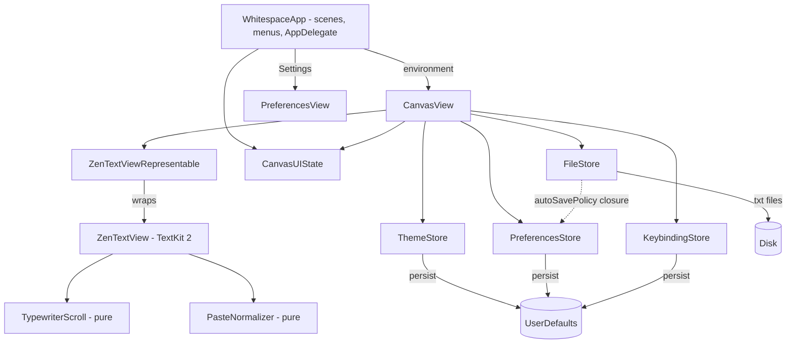

# Whitespace — Architecture

*Final document of the fable-review-1 engagement (audit `a204d70` → refactors R1–R8). Supersedes `ARCHITECTURE_REVIEW.md` (in git history). Written for future development sessions, including AI sessions: the conventions in §3 are rules, not suggestions.*

---

## 1. Structure

Whitespace is a single-target macOS writing app: a SwiftUI shell around one substantial AppKit editor view. ~2,200 lines of source, 50 tests.

### Stores (state layer)

Five `@Observable @MainActor final class`es, created in `WhitespaceApp`, injected via `.environment()`:

| Store | Owns | Persistence |
|---|---|---|
| `FileStore` | `[FileBuffer]`, active index, save/auto-save, open/save panels, `hasUnsavedChanges` | plain-text files on disk |
| `PreferencesStore` | font size, line height, column width, scroll speed, auto-save & overlay settings | UserDefaults |
| `ThemeStore` | current/previous `Theme`, manual ~60 fps transition loop, color interpolation | UserDefaults |
| `KeybindingStore` | 6 customizable editor delete actions | UserDefaults (JSON `ShortcutBinding`) |
| `CanvasUIState` | palette/overlay visibility (shared by menu commands and CanvasView) | none |

Cross-store policy is injected as closures at startup (`WhitespaceApp.onAppear`): `fileStore.autoSavePolicy` reads `PreferencesStore` lazily; `AppDelegate.fileStore` enables the dirty-quit prompt. Stores never import views and never reference each other directly.

### Views

`CanvasView` (composition root) = `GrainBackground` + centered `ZenTextViewRepresentable` + `CommandPaletteView` / `ShortcutOverlayView` overlays. `PreferencesView` lives in the Settings scene. `WhitespaceApp.commands` defines all menu items; menu items toggle `CanvasUIState` or call stores directly.

### Editor

`ZenTextView` (NSTextView subclass, TextKit 2) owns: typewriter scrolling (single scroll authority — `scrollRangeToVisible` override routes everything through `recenter`), custom caret (`CursorBarView` + blink timer + system-indicator suppression), `keyDown` dispatch for non-menu chords, bold/italic, paste normalization. Pure logic is extracted beside it:

- `TypewriterScroll.target(for:)` — the scroll placement/deadzone decision (11 tests)
- `PasteNormalizer` — staged paste/drag normalization (pure, tested)

### Data flow for text

Keystroke → `ZenTextView` → delegate `textDidChange` → `Binding<String>` → `FileStore.updateActiveText` (marks dirty, schedules per-buffer auto-save when the policy says so). External change (open, buffer switch) flows back through `updateNSView`, which resets `.string` and **must** run the established reset block (see §3.4).

## 2. What the engagement changed (R1–R8)

| | Change |
|---|---|
| R1 | Undo enabled (`allowsUndo`); undo stack cleared on buffer switch |
| R2 | Dead command-layer code deleted (menu-duplicate `keyDown` branches never ran — AppKit dispatches menu equivalents first) |
| R3 | Untitled ⌘S → Save As panel; per-buffer auto-save captured by id; dirty-quit prompt; `saveActive` de-asynced |
| R4 | Palette/overlay get real menu items (⌘/ reachable for the first time); palette keys fixed; focus returns to editor on dismissal |
| R5 | Auto-save policy into `FileStore`; editor closure params removed |
| R6 | Scroll math extracted into `TypewriterScroll` with characterization tests |
| R7 | Keybinding Record button wired (NSEvent monitor, conflict surfacing) |
| R8 | `closeActive()` removed; panel ink into `Theme.panelInkColor`; truthful `ThemeStore.set` comment |

## 3. Conventions for new code (rules)

1. **New shared state** = `@Observable @MainActor final class`, UserDefaults injected through `init(defaults:)` for testability, keys namespaced `whitespace.<area>.<name>`. No singletons, no Combine, no protocol-for-one-implementation.
2. **New command/shortcut**: add a real menu item in `WhitespaceApp.commands` — that is the single dispatch point for any chord a menu can express. Never add a disabled placeholder menu item. Never duplicate a menu chord in `keyDown` (it will be dead code; the menu intercepts first). `keyDown` is only for chords menus can't own (currently ⌘B/⌘I/⌘+/⌘− and `KeybindingStore` lookups). When adding an app-level shortcut, also update `ShortcutOverlayView.appShortcuts`.
3. **Keyboard handling in SwiftUI overlays**: `.onKeyPress` does NOT fire while an AppKit field editor (TextField) has focus. Use the established patterns from `CommandPaletteView`: `.onSubmit` for Return, invisible `Button` + `.keyboardShortcut(_, modifiers: [])` for arrows, local `NSEvent` monitor (installed `onAppear`, removed `onDisappear`) for Escape.
4. **Wholesale text replacement** (`textView.string = …` in `updateNSView`) must keep the full reset block together: `invalidateScrollAnchor()` → `undoManager?.removeAllActions()` → set string → `applyFont` → `applyColors`. Breaking this up reintroduces stale-anchor scrolling, cross-buffer undo, or unstyled text.
5. **Saving**: every user-initiated save goes through `saveActiveOrPrompt()` (handles untitled). Auto-save goes through `scheduleAutoSave` only (per-buffer debounce, id captured at schedule time). Anything that creates unsaved state must keep `isDirty` accurate — the quit prompt depends on it.
6. **Editor logic** that is decision-shaped (geometry, classification, normalization) lives in a pure type next to `ZenTextView` with value-type inputs and unit tests — `TypewriterScroll` and `PasteNormalizer` are the exemplars. TK2/AppKit calls stay in the view; decisions move out.
7. **Tests**: XCTest; stores tested with `UserDefaults(suiteName:)` + domain wipe in tearDown; `ZenTextView` behavior tested by hosting it in an offscreen `NSWindow` (see `ZenTextViewUndoTests`); `keyDown` dispatch tested with constructed `NSEvent.keyEvent` chords.
8. **Adding files**: the pbxproj is generated — run `xcodegen generate` after creating a file, never edit `project.pbxproj` by hand.
9. **Definition of done**: clean build + full test suite green + (for UI changes) the behavior observed in the running app. One concern per commit.
10. **Product philosophy**: read `DESIGN.md` before adding any UI. No visible chrome in the writing surface, no toolbars, no color-as-affordance. If a feature's value is "lets the user fiddle with presentation," it is the wrong feature.

## 4. Deliberate debt and open items

**Open product decision — rich text vs plain text (S4).** The editor supports ⌘B/⌘I and paste preserves bold/italic/underline, but persistence is plain `.txt` and a buffer switch discards in-memory formatting. Resolve on `feat/nsdocument-markdown` (either persistence carries formatting, or formatting features come out). *Owner discussion pending — do not patch piecemeal.*

**Open bug — typewriter recentering doesn't follow sustained typing.** Pre-existing (verified identical at the pre-engagement baseline): the viewport can stay pinned while the caret walks below the deadzone. The decision math is tested and exonerated; suspect TK2 stale caret geometry in `handleSelectionChange`'s deferred recenter or the `currentScrollTarget` cache. Needs its own investigation; behavior-changing fix requires owner approval.

**Kept as-is, on purpose:**
- Full-storage `foregroundColor` repaint ~94×/theme toggle (L6) — imperceptible at prose scale; revisit only if long-document profiling demands.
- `try?` error swallowing on file I/O — no error-surfacing UI exists yet; a save failure is currently silent. Acceptable for now; revisit with the S4 decision.
- Brute-force insertion-indicator suppression (view-tree walk + class-name matching) — fragile by necessity against TK2's private indicator; re-verify after macOS updates.
- Manual ~60 fps theme-transition Task loop — simplest correct way to animate into AppKit.
- Mid-transition theme toggle visibly jumps (rapid double-toggle only) — documented at `ThemeStore.set`.
- NSOpen/NSSavePanel methods live directly in `FileStore`; `WindowConfigurator`/`PrefsWindowAccessor` duplication — right-sized, do not abstract.
- O(n) full-string text sync per keystroke — fine at prose scale; no incremental diffing.
- `ShortcutBinding.displayString` renders some keyCodes oddly on machines with keyboard remappers (UCKeyTranslate quirk) — environmental, data layer is correct.
