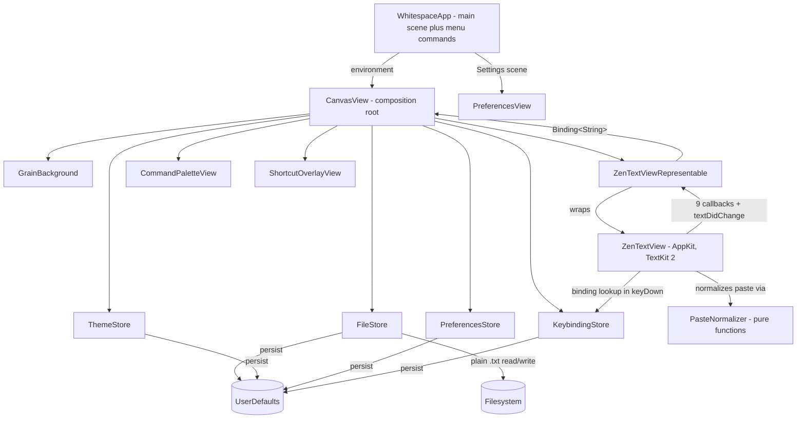

# Whitespace — Architecture Review

*Phase 1 audit deliverable. Branch `fable-review-1`, base commit `bcafa25`. No code was changed.*

**Method.** Every source file (18 files, ~2,000 lines), every test file, `DESIGN.md`, `project.yml`, and the full git history were read. Findings were challenged by an independent second review pass over the same code. Two findings that couldn't be verified statically were checked by running the app (results in §2.1). Baseline at `bcafa25`: clean build, all 33 tests pass.

---

## 1. Current architecture

Whitespace is a single-target macOS app: a SwiftUI shell around one substantial AppKit view.

**Composition.** `WhitespaceApp` (@main) creates four stores and injects them via `.environment()`. All four are `@Observable @MainActor final class`es persisting to `UserDefaults`:

| Store | Owns |
|---|---|
| `FileStore` | `[FileBuffer]` (url + plain text + dirty flag), active index, open/save/auto-save, NSOpen/NSSavePanel |
| `ThemeStore` | current/previous `Theme`, a manual ~60 fps transition loop, color interpolation |
| `PreferencesStore` | font size, line height, column width, scroll speed, auto-save & overlay-dismiss settings |
| `KeybindingStore` | 6 customizable editor delete actions (`ShortcutBinding` ↔ UserDefaults JSON) |

**View tree.** `CanvasView` is the composition root: `GrainBackground` (theme color + CIFilter grain) → centered `ZenTextViewRepresentable` → conditional `CommandPaletteView` and `ShortcutOverlayView` overlays. `PreferencesView` lives in the `Settings` scene.

**The editor.** `ZenTextView` (731 lines, NSTextView subclass on TextKit 2) is the heart of the app and owns: typewriter-scroll engine (single scroll authority via `scrollRangeToVisible` override + paragraph-anchor math), custom caret rendering (`CursorBarView` + blink timer + multi-layer suppression of the system insertion indicator), keyboard dispatch (`keyDown` with hardcoded keyCodes + `KeybindingStore` lookup), bold/italic toggling, and paste/drag normalization via `PasteNormalizer` (pure, staged, well-tested).

**Data flow for text.** Keystroke → `ZenTextView` → delegate `textDidChange` → `Binding<String>` (`CanvasView.activeText`) → `FileStore.updateActiveText` → buffer copy. External change (file open, buffer switch) flows back: `updateNSView` compares `textView.string != text` and resets the whole string. Document text therefore lives in **two places** — `NSTextStorage` (attributed) and `FileBuffer.text` (plain) — reconciled by full-string comparison.

Dependency direction is healthy: views → stores → Foundation/AppKit. No store knows about any view. The one inversion is `ZenTextView` holding a `KeybindingStore?` reference (an AppKit view reading a store directly), which is pragmatic rather than wrong.

### 1.1 Runtime verification results

| Check | Result |
|---|---|
| ⌘P (command palette) | **Works** — palette opens. The disabled placeholder menu item does *not* swallow the key equivalent. |
| ⌘/ (shortcut overlay) | **Broken** — no overlay appears. Confirmed with the editor focused, via two independent key-synthesis paths. The overlay has no other entry point, so the feature (and `ShortcutOverlayView`, 88 lines) is unreachable. |
| Escape in the palette | **Broken** — palette does not dismiss. The `.onKeyPress` handlers on the search field don't fire (arrows/Return use the same mechanism and are presumed equally dead; untested). Click-outside dismissal works. |
| Focus after palette dismissal | **Broken** — typing goes nowhere until you click the editor again. |
| Typing color after launch (suspected `typingAttributes` clobber) | **Does not manifest** — typed text renders in the correct theme color; NSTextView falls back to its view-level `textColor`. Latent fragility only. |
| Menu bar | Two "View" menus appear (system View menu + the custom `CommandMenu("View")`). |

*Caveat: the test machine runs third-party keyboard/window tooling (Karabiner et al.). The ⌘/ failure was confirmed via two paths and is almost certainly real; re-verify once during the fix.*

---

## 2. Systemic issues

Ordered by how much they will compound as the app grows.

### S1. The keyboard/command layer is defined in four places and partially fictional

One logical concept — "the app's commands and their shortcuts" — is spread across:

1. `ZenTextView.keyDown` (`ZenTextView.swift:646-681`): hardcoded keyCode comparisons for 13 chords.
2. `WhitespaceApp.commands` (`WhitespaceApp.swift:26-52`): menu items re-wiring the same operations (Save/Open/New/theme), plus two **permanently disabled placeholder buttons** for ⌘P and ⌘/.
3. `ShortcutOverlayView.appShortcuts` (`ShortcutOverlayView.swift:8-19`): a third, hand-maintained list of display strings.
4. `KeybindingStore` / `KeybindingAction`: the real, customizable system — but covering only 6 delete actions.

It's worse than duplication: AppKit dispatches ⌘-equivalents through the menu **before** `keyDown` ever fires, so the `keyDown` branches for ⌘Z/⌘⇧Z/⌘S/⌘⇧S/⌘O/⌘N/⌘⇧D are dead code. The save the user gets via ⌘S is the *menu's* closure, not `keyDown`'s. A reader (or an AI session) modifying the `keyDown` save path would change nothing and not know why. Meanwhile the runtime checks show the placeholder scheme half-works: ⌘P reaches `keyDown`, ⌘/ never arrives. Every new command currently means touching 3–4 files and guessing which path actually executes.

**Direction:** don't build a command-registry abstraction. Make each layer truthful: real menu items for palette/overlay that toggle shared state (which also fixes ⌘/ and removes the double "View" menu), delete the dead `keyDown` branches, leaving only what the menu can't do (⌘B/⌘I/⌘+/⌘−), and derive the overlay's app-shortcut list from one constant table next to the menu definition.

### S2. Data-safety gaps cluster around FileStore (`FileStore.swift`)

For a writing app, this cluster is the highest-stakes finding. All four are *behavior-changing fixes*, so per the engagement rules they are flagged here and not silently bundled into refactors:

- **No undo.** `allowsUndo` is never set (defaults to `false` for programmatic NSTextViews), so Edit ▸ Undo is permanently disabled and the (dead, see S1) ⌘Z handlers act on an empty undo manager. One errant ⌘A + keystroke irrecoverably destroys the document. Two-line fix (`configure()` + `removeAllActions()` in the buffer-switch branch of `updateNSView`).
- **⌘S on an untitled buffer is a silent no-op** (`saveActive` guards on `buffer.url` and returns). The natural fix falls through to `saveAsPanel()`.
- **`isDirty` is written but never read.** There is no `applicationShouldTerminate` check, so quitting with unsaved changes loses them without a prompt — and auto-save is **off by default**.
- **Auto-save can save the wrong buffer.** `scheduleAutoSave` resolves `activeBuffer` *at fire time* (`FileStore.swift:53-60`): edit A, switch to B within the delay → A's edits are never saved and B is rewritten. Fix: capture the buffer's `id` when scheduling. (Bounded today: auto-save is opt-in and multi-buffer use is rare.)

Supporting structural smells, behavior-preserving to fix: `saveActive()` is synchronous main-thread I/O wearing an `async` signature, which forces `Task { try? await … }` ceremony — and `try?` error-swallowing — at all four call sites; auto-save *policy* (the enabled check + delay) lives in `CanvasView.onChange` rather than with the store.

### S3. Two sources of truth for document text, reconciled lossily

The NSTextStorage ↔ `FileBuffer.text` round-trip (§1) costs an O(n) string bridge + compare per keystroke *and* per observable change — including every tick of the theme transition (~94 ticks per toggle, see S5). At prose scale that's affordable; the structural problem is the reconciliation is **lossy**: `updateNSView`'s reset path (`ZenTextViewRepresentable.swift:95-108`) sets `.string`, destroying all in-memory bold/italic/underline, then re-applies uniform attributes.

This is one face of the app's deepest unresolved decision — see S4. Don't build incremental sync; resolve S4 first.

### S4. Rich text in memory, plain text on disk (unresolved product decision)

The app actively supports formatting — ⌘B/⌘I, and `PasteNormalizer` carefully *preserves* bold/italic/underline — yet persistence is `tv.string` written as `.txt`, and a mere buffer switch (S3) destroys formatting without saving anything. Users can create formatting they will silently lose. The unmerged `feat/nsdocument-markdown` branch shows this is known and in flight.

**Recommendation: decide, don't refactor.** Either formatting is real (then persistence must carry it — markdown or RTF, ideally via the NSDocument work on that branch) or it isn't (then drop ⌘B/⌘I and collapse `PasteNormalizer` to plain-text). Patching either half on `main` while the branch is open would be wasted motion. Noted here per the rules; no change proposed in this engagement.

### S5. The command palette is half-broken and the callback plumbing obscures it

Runtime checks (§1.1): Escape doesn't dismiss the palette, keyboard navigation is presumed dead with it, focus doesn't return to the editor on dismissal, and ⌘/ never opens the overlay. These aren't four bugs; they're one seam — UI toggled deep inside AppKit `keyDown`, communicated up through **ten** parallel closures (`ZenTextView.swift:5,12-20` → `ZenTextViewRepresentable.swift:13-21` + `wire()` → `CanvasView.swift:35-43`), with focus handed between an NSViewRepresentable and a SwiftUI overlay and never handed back. One of the ten (`onTextChange`) is never assigned — text actually flows through the delegate. Adding a command touches four places; five of the closures duplicate menu items that already fire (S1).

**Direction:** collapse the closures into one small actions struct passed once, fix focus restoration on dismissal, and give palette/overlay real menu entry points (S1). Still no registry needed.

### S6. The keybinding Record button does nothing

`KeybindingsTabView` (`PreferencesView.swift:173-225`) toggles `recordingAction` and relabels the button, but no key-capture path exists anywhere — `KeybindingStore.setBinding` (with working conflict detection, persistence, and tests) is called only from tests. The feature is ~90% built and fully tested; the last ~30 lines (a local `NSEvent` monitor while recording) were never written. Until then, the six "customizable" bindings are immutable defaults — and the Preferences UI quietly misleads.

---

## 3. Local issues

Worth fixing opportunistically; none urgent.

| # | Issue | Where |
|---|---|---|
| L1 | `KeybindingAction.defaults` static dictionary — zero call sites, duplicates `defaultBinding` | `KeybindingAction.swift:23-35` |
| L2 | `LineHeight` enum unused; the picker tags raw doubles 1.4/1.6/1.8 | `PreferencesStore.swift:15-19`, `PreferencesView.swift:87-89` |
| L3 | `onTextChange` callback never assigned (dead; text flows via delegate) | `ZenTextView.swift:5,709` |
| L4 | Stale comment: claims the theme cursor is 0.5 alpha; `Theme.cursorColor` is 1.0, so `withAlphaComponent(0.85)` *dims* rather than strengthens. Fix the comment, not the 0.85 | `ZenTextView.swift:487-490` |
| L5 | `closeActive()` has no app-side caller (palette has no close command yet) — keep or wire, just decide | `FileStore.swift:40-44` |
| L6 | Theme transition repaints `.foregroundColor` over the whole text storage ~94× per toggle. Imperceptible at prose scale; revisit only if long-document profiling says so | `ThemeStore.swift:45-62`, `ZenTextView.swift:540-544` |
| L7 | `ShortcutOverlayView` hardcodes panel ink colors (`#7D6D6C` vs theme text `#6B5B5E`) outside `Theme`. Looks deliberate (brighter panel ink); move into `Theme` so the knowledge has one home | `ShortcutOverlayView.swift:21-29` |
| L8 | Double "View" menu (system + `CommandMenu("View")`) — verified at runtime | `WhitespaceApp.swift:40` |
| L9 | Mid-transition theme toggle visually jumps (comment says `previous` should snapshot the on-screen blend; code snaps to the un-blended `Theme`). Cosmetic, rapid double-toggle only | `ThemeStore.swift:35-43` |
| L10 | `caretCenterTargetY()` — the subtlest math in the app — is untestable as a private method on an NSTextView needing a live scroll view. Extractable into a pure function (see R6) | `ZenTextView.swift:302-382` |

---

## 4. What's actually fine

Things that look unusual but are right-sized for this app. **Do not "fix" these.**

- **Four `@Observable @MainActor` stores via `.environment()`** — consistent, testable (UserDefaults suite injection throughout), correct concurrency. This is the app's pattern; keep using it.
- **`ZenTextView` at 731 lines.** Cohesive editor concerns, not a god object. Extract the scroll geometry (R6); do not shatter the class.
- **The manual ~60 fps theme-transition Task loop.** Simplest correct way to drive an animation into AppKit-land. Don't replace with CADisplayLink machinery or SwiftUI animation plumbing.
- **The brute-force insertion-indicator suppression** (walking the window's view tree, name-matching private classes, re-suppressing in `viewWillDraw`). Ugly, fragile *by necessity* — it's the only reliable way to suppress TK2's `NSTextInsertionIndicator`. Cost is trivial at this view-tree size. Watch it across macOS updates.
- **NSOpenPanel/NSSavePanel inside `FileStore`.** Two thin methods; everything testable already has seams and tests. A panel-presenter protocol would be enterprise-itis.
- **O(n) full-string text sync per keystroke.** Irrelevant at prose scale. No incremental diffing.
- **`scrollRangeToVisible` discarding its range** — deliberate, well-commented single scroll authority. Revisit only when find-in-page exists.
- **`WindowConfigurator` / `PrefsWindowAccessor` duplication** — two call sites configuring *different* windows with different settings. Parameterizing would cost more than it saves.
- **Mixed `didSet` vs private-backing persistence in `PreferencesStore`** — the backing-var pattern exists exactly where clamping is needed; `didSet` where it isn't. Two tools, two jobs.
- **`FileBuffer` copy-mutate-reassign** — idiomatic `@Observable` value semantics.
- **`PasteNormalizer`** — pure staged functions, real tests at both unit and pasteboard-integration level. This is the house style the rest of the code should converge toward.

---

## 5. Prioritized recommendations

Ordered by leverage ÷ (risk × effort). Behavior-**changing** items are marked **[BEHAVIOR]** and need your explicit sign-off per the engagement rules; the rest preserve behavior exactly. Each item is one commit.

**Suggested Phase 2 order (smallest blast radius first): R1 → R2 → R3 → R4 → R5 → R6 → R7.**

| # | Change | Why | Blast radius | Verification |
|---|---|---|---|---|
| **R1** [BEHAVIOR] | **Enable undo**: `allowsUndo = true` in `configure()`; `undoManager?.removeAllActions()` in `updateNSView`'s wholesale-replacement branch | Eliminates the worst data-loss vector in a writing app; strictly additive | ~3 lines, 2 files | Build + suite; run app: type, ⌘Z restores, switch buffers, ⌘Z can't resurrect the other buffer's text |
| **R2** | **Dead-code sweep**: L1, L2, L3, L4 comment, the dead `keyDown` branches (⌘Z/⌘⇧Z/⌘S/⌘⇧S/⌘O/⌘N/⌘⇧D), and the unused `defaults` dict | Makes the command layer truthful before touching it further; pure deletion, lowest risk | Deletions across 4 files; no logic changes | Build + suite; run app: ⌘S/⌘O/⌘N still work (proving the menu path was the live one all along) |
| **R3** [BEHAVIOR] | **Data-safety trio in FileStore**: (a) untitled ⌘S falls through to Save As; (b) `scheduleAutoSave` captures buffer `id` at schedule time and saves *that* buffer; (c) `applicationShouldTerminate` prompts when any buffer `isDirty` | Closes the remaining silent-loss paths; finally gives `isDirty` a consumer | `FileStore.swift` + a small app delegate in `WhitespaceApp.swift` | Characterization tests first for save/auto-save; new tests: untitled save prompts, wrong-buffer case saves the edited buffer; manual quit-with-dirty check |
| **R4** [BEHAVIOR] | **Fix palette/overlay entry points & focus**: real menu items toggling shared state (fixes unreachable ⌘/, removes placeholders, dedupes the View menu); restore editor focus on palette dismissal; make Escape dismiss work | Restores two advertised features (§1.1); removes the half-fictional placeholder scheme (S1) | `WhitespaceApp.swift`, `CanvasView.swift`, `CommandPaletteView.swift` | Run app: ⌘P and ⌘/ both open/close, Escape dismisses, typing works immediately after dismissal |
| **R5** | **Collapse the ten callbacks into one `EditorActions` struct** passed once through the representable; auto-save policy moves out of `CanvasView.onChange` into `FileStore` (observing prefs values passed in) | Adding a command stops touching four files; policy lives with the data it governs | Mechanical; `ZenTextView`, representable, `CanvasView` | Build + suite; spot-check every remaining shortcut in the running app |
| **R6** | **Extract typewriter-scroll geometry** (`caretCenterTargetY` decision math) into a pure static function with value-type inputs; characterization-test both regimes (paragraph-change placement + clamps; deadzone hold/exit) | Fences the subtlest, least-testable code in the app before future work (nsdocument branch) lands on top of it | `ZenTextView.swift` + new test file; rendering behavior identical | New unit tests pass; manual feel-check of typewriter scrolling (type, Enter, click around, resize) |
| **R7** [BEHAVIOR] | **Wire the Record button**: local `NSEvent` key monitor while `recordingAction != nil`, routed through the already-tested `setBinding`, surfacing `KeybindingError.conflict` in the existing `conflictMessage` | Finishes a 90%-built, fully tested feature; honest Preferences UI | `PreferencesView.swift` only | Run app: record a custom chord, conflict rejected with message, persists across relaunch (store tests already cover persistence) |

**Deliberately not recommended:** S4 (rich-text persistence — decide on the `feat/nsdocument-markdown` branch, not here), L6 (transition repaint perf), any command-registry/DI abstraction, incremental text sync.

---

*Phase 2 process (agreed): one item per commit, plan stated before each change, characterization tests before touching uncovered code, build + full suite after each change, stop-and-revert if risk exceeds estimate. On completion this document becomes `ARCHITECTURE.md` (resulting structure + conventions for future sessions + retained debt).*
